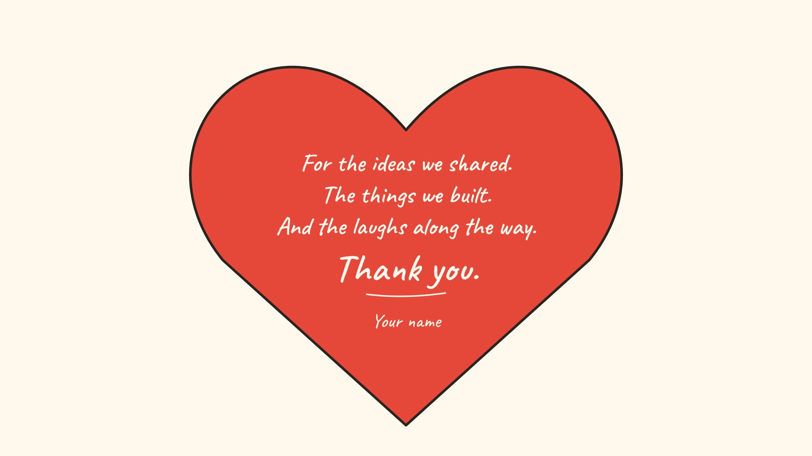

# Along the Way

An editable ink-style goodbye film made with Remotion, React and SVG. Two colleagues share an idea, build something, laugh, and say goodbye. A red heart carries the final message.

Created by **Dessi G**. Adapt it for a farewell, a team thank-you or your own short story.


**50 seconds · 1920 × 1080 · 24 fps · eight connected scenes**

## Start the preview

Use Node.js 22.13+ (or another version allowed by `package.json`) and npm.

```sh
git clone https://github.com/DG-creative-lab/ink-goodbye-remotion.git
cd ink-goodbye-remotion
npm ci
npm run dev
```

Open the local URL printed by Remotion and choose **Ink-Goodbye-Film**. The template starts silently. Each scene is also available separately, along with a character pose sheet and a helping-hand study.

## Make it yours

Copy `props.example.json` to `props.local.json` and edit the message, signature and optional music settings. Keep the three message lines short enough to fit inside the heart. An empty signature is allowed.

```json
{
  "lineOne": "For the ideas we shared.",
  "lineTwo": "The things we built.",
  "lineThree": "And the laughs along the way.",
  "closing": "Thank you.",
  "signature": "Your name",
  "musicFile": "",
  "musicStartSeconds": 0,
  "musicVolume": 0.7
}
```

Pass that file to the render commands below. To change the Studio defaults, edit the inline `defaultProps` in `src/Root.tsx`, or edit the composition's props in Studio. The frame-driven poses and SVG drawings live in `src/ink/`.

For music, place a recording you can use in `public/audio/` and set `musicFile` to `audio/your-recording.mp3`. Choose the excerpt with `musicStartSeconds`; `musicVolume` is between 0 and 1. No recording is included, fetched or required. Local audio and `props.local.json` are ignored by Git.

## Export an MP4

The verified export path captures vector print frames, rasterizes them with PDFium, then encodes H.264 video and optional AAC audio. It avoids the incomplete SVG painting found in ordinary browser screenshot exports on the original development machine. The artwork remains editable SVG.

Install Python 3.10+, FFmpeg (including `ffprobe`), and the two Python rendering dependencies:

```sh
python3 -m venv .venv
# macOS / Linux:
source .venv/bin/activate
# Windows PowerShell: .venv\Scripts\Activate.ps1
python -m pip install -r requirements-render.txt
```

With the virtual environment active, set the Python command once so the renderer uses that environment:

```sh
# macOS / Linux:
export PYTHON=python
# Windows PowerShell: $env:PYTHON = "python"
```

```sh
npm run render -- --props props.local.json --output out/my-goodbye.mp4
```

The renderer can find Chrome in common install locations; otherwise Remotion downloads its browser. You can set `REMOTION_BROWSER_EXECUTABLE` to a compatible browser path. `PYTHON`, `FFMPEG` and `FFPROBE` may also be set explicitly. macOS was the verified export platform; Linux and Windows browser/FFmpeg combinations need their own visual review.

The script checks the output dimensions, frame count and **every decoded video frame** against its clean source PNG, then writes a verification JSON beside the MP4. Review the result in a video player before sharing, especially after changing poses or wording. Tests and pixel comparisons do not judge the storytelling.

A still or a small export smoke test:

```sh
npm run render:still -- --props props.local.json --output out/ending.png
npm run render -- --frames 0:11 --output out/smoke.mp4
```

Frame ranges are inclusive and refer to the full film. A range export is intended for testing; the standard command exports all 1,200 frames. Outputs are protected from accidental overwriting; add `--overwrite` when intended. `--workers 1` reduces memory use. Intermediate vector/PNG files remain under `out/` and may be deleted after review.



## Story and source

| Time | Beat | Source |
| --- | --- | --- |
| 0–4s | Sketch an idea together | `InkIdeaStage.tsx`, `inkIdea.ts` |
| 4–8s | Turn the plan into real materials | Same continuous opening clock |
| 8–12s | Carry an ambitious stack | `scenes/InkLoad.tsx` |
| 12–18s | A helping hand | `scenes/InkHelp.tsx` |
| 18–23s | Put the blocks down together | `inkSetDown.ts` |
| 23–28s | Share a laugh | `inkActing.ts` |
| 28–38s | Walk to the door and wave | `inkJourney.ts`, `inkVisitors.ts` |
| 38–50s | Leave, then reveal the signed heart | `inkEnding.ts`, `InkHeartEnding.tsx` |

The same two-link gait drives the protagonist and arriving colleagues. Ground contacts, spacing, hand/pencil contact, board-support elbows and scene handoffs have regression checks. Red is reserved for the final heart; cobalt and marigold identify the shared materials.

## Check changes

```sh
npm run check
```

This runs ESLint, TypeScript, the motion/continuity tests and a production bundle. No prior exports, personal folders or archived verification files are needed. Review rendered movement as well as the tests when changing anatomy or blocking.

To package the committed source from a Git checkout:

```sh
npm run pack:source
```

## License and credits

Our code and vector artwork are [MIT licensed](LICENSE). Caveat is bundled under its [SIL Open Font License](public/fonts/caveat/OFL.txt). Remotion has its own [license terms](https://www.remotion.dev/docs/license/pricing); this project's MIT license does not replace them. See [NOTICE.md](NOTICE.md).
